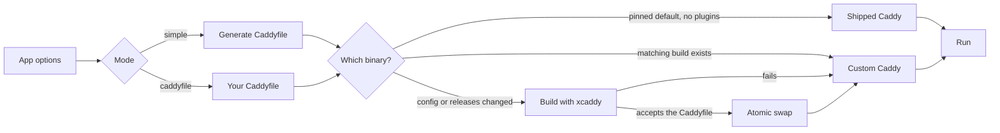

<!-- header:begin (generated from project metadata) -->
<h1 align="center">
  
  <br>
  Caddy Forge
</h1>

<p align="center">
  <a href="https://my.home-assistant.io/redirect/supervisor_add_addon_repository/?repository_url=https%3A%2F%2Fgithub.com%2Fseb5594%2FHome-Assistant-Apps"></a><br>
  <a href="https://github.com/seb5594/Home-Assistant-Caddy-Forge-App/releases"></a>
  <br>
  
  
  
  <a href="https://github.com/seb5594/home-assistant-base-multi-arch"></a>
  <br>
  <a href="https://github.com/seb5594/Home-Assistant-Apps/stargazers"></a>
  <a href="https://github.com/seb5594/Home-Assistant-Apps/forks"></a>
  <a href="https://github.com/seb5594/Home-Assistant-Caddy-Forge-App/actions/workflows/ci.yml"></a>
  
  <a href="https://github.com/seb5594/Home-Assistant-Apps/issues"></a><br>
  <a href="https://paypal.me/seb5594"></a>
  <a href="https://buymeacoffee.com/seb5594"></a><br>
  <a href="https://github.com/seb5594/Home-Assistant-Apps#license"></a>
</p>
<!-- header:end -->

**🇬🇧 English** · [🇩🇪 Deutsch](README.de.md)

Caddy and its build workshop in a single Home Assistant app. Start with the pinned upstream release, or
list the plugins you need and let the app compile a matching binary, check for newer releases on every
start and swap the result in only after it passed validation. No Caddyfile knowledge needed for the usual
setups; a full Caddyfile mode is there when they are not enough.

## Highlights

- **Plugins as a list.** One Go module per row in the app configuration, with optional `@version`.
  Pasted `--with …` lines from an xcaddy command work as they are.
- **Safe updates.** Builds happen in a scratch folder, the new binary has to understand your configuration,
  and only then does a single rename replace the old one. A failed build changes nothing.
- **Update check on start.** For `latest` and for plugins without a pinned version: install, just notify,
  or stay offline.
- **Simple mode.** Reverse proxy, static files, redirects, free certificates (also via DNS and wildcard),
  logins and allow lists, written as a form instead of a Caddyfile.
- **Websites from git.** A site type that serves a repository and keeps it current; no plugin needed.
- **Admin UI.** A web front end for Caddy's admin API, always on and opened from Home Assistant's sidebar.
- **Caddyfile mode.** Seeded from your simple setup the first time, yours from then on. One switch takes over the plugins and Caddy version of CaddyBuilder and the Caddyfile of Caddy 2, so two apps become one.
- **Starts instantly by default.** The pinned Caddy release ships in the image; the Go toolchain only
  works when a build is actually needed.
- **Every architecture:** amd64, aarch64, armv7, armhf and i386. Builds adapt to the free memory and
  run at low priority.

## Getting started

1. Add this repository to the Home Assistant app store, install **Caddy Forge** and open the configuration.
2. Put your domain into the default site, choose the certificate type and forward ports 80 (the app listens on 8080) and 443.
3. Add `use_x_forwarded_for` and `trusted_proxies` to Home Assistant's `http:` settings.
4. Start the app.

A configuration with a plugin, a DNS-validated wildcard certificate and two sites looks like this:

```yaml
mode: simple
caddy:
  version: 2.11.9
  modules:
    - module: hslatman/caddy-crowdsec-bouncer     # owner/repo is taken from github.com
      version: main                               # optional tag, branch or commit
    - module: mholt/caddy-l4
      enabled: false                              # kept, but not part of the build
  updates: install
simple:
  email: you@example.org
  dns_provider: cloudflare        # adds github.com/caddy-dns/cloudflare to the build
  dns_token: !secret cloudflare_token
  sites:
    - domain: "*.example.org"
      type: proxy
      target: localhost:8123
    - domain: files.example.org
      type: static
      target: /share/www
      auth_user: family
      auth_password: !secret files_password
```

The full option reference, update behavior and troubleshooting are in the [app documentation](caddy-forge/DOCS.md).
More to read:

- [Practical examples](docs/examples.md): private homepage, website from git, PHP and single-page apps, wildcard certificates
- [Moving from the Caddy 2 and CaddyBuilder apps](docs/migrating-from-the-caddy-2-app.md): one switch takes over plugins, version and Caddyfile; a mapping of the old options
- [Moving from nginx or Apache](docs/migrating-from-nginx-and-apache.md): directive tables and a worked example

## How it works



## Repository layout

| Path | Purpose |
| --- | --- |
| `caddy-forge/config.yaml`, `translations/` | App metadata, options and their English and German texts |
| `caddy-forge/run.sh` | Start sequence: options, Caddyfile, binary selection, server |
| `caddy-forge/rootfs/usr/lib/caddy-forge/` | One library per concern: `options`, `modules`, `versions`, `builder`, `caddyfile`, `gitsites`, `adminui`, `migrate`, `log` |
| `docs/` | Examples and migration guides in English and German |
| `.github/tests/` | Runtime tests that run inside the built image, including a real plugin build |
| `.github/checks/` | Project rules: pinned version in sync, defaults match the schema |
| `branding/` | SVG sources of icon and logo |

## Development

Versions follow `YYYY.MM.DD`, with `.1`, `.2` … for further builds on the same day. Raise `version` in
`config.yaml` and `BUILD_VERSION` in the `Dockerfile` together and add a [changelog](caddy-forge/CHANGELOG.md) entry.
The Caddy version in the options default and `ARG CADDY_VERSION` in the `Dockerfile` must name the same upstream release;
`.github/checks/app_consistency.py` enforces it.

The tests run in the image the same way the pipeline does:

```bash
docker build --build-arg BUILD_ARCH=amd64 -t caddy-forge caddy-forge
docker run --rm --entrypoint /bin/bash \
  -v "$PWD/.github/tests/runtime.sh:/runtime.sh:ro" -v "$PWD/.github/tests:/tests:ro" \
  caddy-forge /runtime.sh        # FORGE_TEST_BUILD=0 skips the real build
```

<!-- support:begin (generated, shared text) -->
## Say thanks

All my projects are built in my spare time, just for the fun of it. Still, they take a lot of time and care, and many of the smart home gadgets I buy end up here because I want to make them cloud-free and smart-home ready. Every bit of support means a lot to me.

If my work helped you or turned out to be useful, show your appreciation with a hot drink for my next sleepless night.

[](https://paypal.me/seb5594) [](https://buymeacoffee.com/seb5594)
<!-- support:end -->

<!-- license:begin (generated from the license file) -->
## License

[](LICENSE)

Published under the [Apache License 2.0](LICENSE).
<!-- license:end -->
